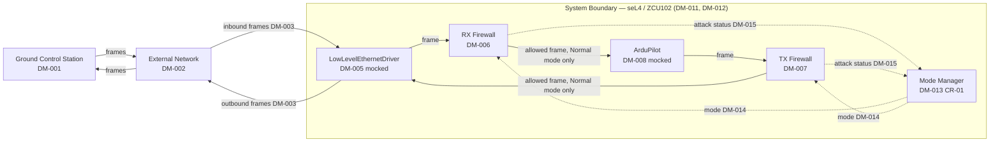

# ConOps – BASS Isolate-Ethernet-Simple

**Light-weight Concept of Operations with Domain Model**
For safety- and security-critical systems.

**Provenance note.** This ConOps was **reverse-engineered on 2026-07-25** from the
existing project artifacts (`sysml/SW.sysml`, `sysml/GumboLib.sysml`, the component
implementations and tests under `hamr/microkit/crates/`) together with the
developer's concept statement quoted in §0. Unlike a ConOps produced by a normal
`SysPlanAndReq` run, the documents here postdate the model — statements below are
descriptive of the system as modeled, and provenance markers identify which facts
come from the concept statement vs. the artifacts.

**Revision history.** v0.2 `[Revision, CR-01, 2026-07-26 — see
action-requests/CR-01-add-RTL-mode/]`: cyber-mode awareness added (Mode
Manager component, attack detection in both firewalls, Init/Normal/RTL modes
with mode-gated mediation). Revised: §1 scope, §2 overview, §5 (OPS-001/002
mode notes; new OPS-003), §6 (FUNC-5/6), §7 (posture, threat table,
contingency), §9 (assumptions 6–8), Appendix A (DM-013–DM-016, diagram). The
§0 developer-concept block is the original system's provenance anchor and is
untouched; the CR-01 concept provenance is the sketch archived in the CR
folder.

---

## 0. Developer Concept (Verbatim)

> the example is a simplified version of the full INSPECTA Open Platform Example.
> The simple version aims to maintain the overall architecture structure and basic
> functions of the full system, but to use dramatically simplified data types and
> firewall rules. The full system also has a MavLink firewall component which is
> omitted here. In the full system, the ArduPilot runs legacy software on a virtual
> machine in an seL4 partition. Here it is mocked.

> Here is a sketch of the purpose of the full system. The INSPECTA tool chain is
> used to secure a legacy UAV autonomy application (ArduPilot) by mediating all
> network traffic between the UAV and external ground control stations. Two
> firewall components -- RX Firewall, TX Firewall, -- enforce security policies on
> ethernet frames flowing in and out of the ArduPilot virtual machine. Each
> firewall runs in its own seL4 protection domain, providing spatial isolation
> enforced by the verified seL4 microkernel.

> In this simplified system, the firewall policies are dramatically simplified and
> idealized and may not make sense with respect to real domain concepts.

Everything after this section may interpret and paraphrase; this block is the
provenance anchor that later `ASSUMED:` markers, audits, and change reports diff
against. (Quoted word-for-word from the developer's launch message of 2026-07-25
requesting these reverse-engineered documents.)

---

## 1. Purpose and Scope

BASS Isolate-Ethernet-Simple is a simplified rendition of the INSPECTA Open
Platform architecture: it secures a (mocked) legacy UAV autonomy application,
ArduPilot, by mediating all ethernet traffic between the autopilot and external
ground control stations. Two firewall components — an RX Firewall on the inbound
path and a TX Firewall on the outbound path — enforce frame-level security
policies, each running in its own seL4 protection domain. The project's role in
this repository is training and HAMR-workflow evaluation, not operational
deployment.

**Scope**
- In scope: the inbound and outbound firewall components with formal (GUMBO)
  policy contracts; a low-level ethernet driver component and an ArduPilot
  component as mocked endpoints of the mediated path; deployment as a HAMR-generated
  seL4 Microkit system with Rust component implementations.
  `[Revision, CR-01, 2026-07-26 — see action-requests/CR-01-add-RTL-mode/]`
  Also in scope: cyber-mode awareness — a Mode Manager component
  (Init/Normal/RTL modes), mocked attack-evidence detection in both firewalls,
  and mode-gated mediation.
- Explicitly out of scope: the full system's MavLink firewall (omitted); running
  actual ArduPilot legacy software in a virtual machine (mocked here); parsing of
  raw ethernet bytes (frame classification arrives pre-decoded — see §9
  Assumption 1; `[Revision, CR-01, 2026-07-26]` one narrow exception: the TX
  Firewall reads byte 0 of the raw payload as the mocked geofence indicator);
  and realistic firewall policy semantics (policies are simplified and
  idealized per §0). `[Revision, CR-01, 2026-07-26]` Mode/reconfiguration
  behavior, previously out of scope, is now **in scope** in the mocked form
  described above; realistic attack detection (traffic analysis, real geofence
  computation) remains out of scope — evidence is mocked from existing message
  fields per the CR-01 sketch.

---

## 2. System Overview

The system is a mediation ring of four periodic components on one processor,
plus `[Revision, CR-01, 2026-07-26]` a fifth, the `Mode Manager`. The
`LowLevelEthernetDriver` (mocked) is the boundary to the physical network: frames
received from the network are handed to the `RX Firewall`, which passes only
well-formed, whitelisted IPv4/TCP frames on to `ArduPilot` (mocked) and drops
everything else. Frames emitted by `ArduPilot` are handed to the `TX Firewall`,
which passes only well-formed ARP or IPv4 frames back to the driver for
transmission and drops everything else. Frames that pass a firewall are copied
through unchanged — mediation is pass/drop only, with no frame rewriting.

`[Revision, CR-01, 2026-07-26 — see action-requests/CR-01-add-RTL-mode/]` The
system is cyber-mode aware. Both firewalls monitor for mocked attack evidence
regardless of mode — the RX Firewall counts malformed inbound frames
(evidence: more than five, cumulatively), the TX Firewall checks each outbound
frame's raw byte 0 for the mocked geofence violation (value 0) — and each
reports an attack status (`OK`/`Attack`) to the `Mode Manager`. The Mode
Manager broadcasts the system mode: it starts in **Init**, shifts to
**Normal** at its 10th activation, and shifts to **RTL** (return-to-launch,
absorbing until restart) when either firewall reports an attack. The firewalls
gate mediation on the sampled mode: in Init and RTL they drop every frame; in
Normal they behave exactly as described above.

**Primary Objectives**
- All network traffic reaching or leaving the (mocked) ArduPilot passes through a
  policy-enforcing firewall component — there is no unmediated path.
- Each firewall's policy is stated as GUMBO contracts on its model interface, so
  conformance of the Rust implementation is machine-checkable (Verus, GUMBOX
  tests).
- The example preserves the overall architecture structure of the full INSPECTA
  Open Platform so workflow experiments on it transfer to the full system.

**Key Stakeholders**
- HAMR workflow developer — uses the project to evaluate HAMR workflows on a
  security-flavored, multi-component architecture.
- Trainees — study the project as an example of securing a legacy application
  with verified isolation and contracted mediation components.

---

## 3. Operational Environment

**Physical / Logical / Regulatory Context**
Runs as a HAMR-generated seL4 Microkit system (Rust component implementations) on
a ZCU102-class processor (model: `ZCU102_Processor`, 1000 ms major frame), in QEMU
or on a development board. In the concept, the platform is a UAV mission computer
communicating with ground control stations over ethernet; in this simplified
project no physical network interface is actually driven (the driver is mocked).

**External Systems / Interfaces** (high-level only)
- Ground control stations (GCS) — external, untrusted-by-default sources and sinks
  of ethernet traffic (concept level; not modeled beyond the frames themselves).
- The external network delivering ethernet frames to, and carrying frames from,
  the platform's network interface.

**Environmental Constraints**
- Standard seL4 Microkit / `no_std` Rust target constraints for HAMR Microkit
  projects.

**Safety-Critical Context**
None modeled — this simplified example carries no safety requirements of its own.
(The full system's UAV context is safety-relevant, but that context is out of
scope here.)

**Security-Critical Context**
The legacy autonomy application is assumed vulnerable and must not be directly
exposed to the network. The threat surface is inbound ethernet traffic (malformed
frames, disallowed protocols, non-whitelisted TCP ports) and unauthorized outbound
traffic. Mitigations are the two firewalls plus seL4 protection-domain isolation.
Policies are idealized (§0) — they illustrate the mediation pattern, not a real
security policy.

---

## 4. User and Stakeholder Characteristics

No interactive human users. The system runs autonomously once deployed; developers
observe behavior through component logs and the test/verification infrastructure.
GCS operators exist only at the concept level (as the remote endpoints of the
mediated traffic) and are not modeled.

---

## 5. Operational Concepts and Scenarios

`[Revision, CR-01, 2026-07-26 — see action-requests/CR-01-add-RTL-mode/]` The
system now has three cyber modes (DM-014): **Init** (first 10 Mode Manager
activations; all frames dropped), **Normal** (baseline mediation, below), and
**RTL** (return-to-launch; entered on attack detection, absorbing; all frames
dropped). OPS-001 and OPS-002 describe **Normal-mode** behavior; OPS-003
describes attack detection and the RTL transition.

### Normal Mode

**Scenario OPS-001: Inbound Frame Mediation** *(revised, CR-01: applies in
Normal mode; in Init/RTL the RX Firewall drops every frame — OPS-003)*
**Trigger / Preconditions:** System initialized; all components dispatched
periodically (DM-012); system mode is Normal (DM-014). A frame arrives from the
External Network (DM-002).
**Steps:**
1. The `LowLevelEthernetDriver` (DM-005) receives an `Ethernet Frame` (DM-003)
   from the network and forwards it to the `RX Firewall` (DM-006). *(Mocked — see
   §9 Assumption 4.)*
2. The `RX Firewall` performs `MediateInbound` (DM-009), classifying the frame by
   its pre-decoded attributes (DM-004): if the frame is well-formed IPv4/TCP and
   its port is on the `Port Whitelist` (DM-010), the firewall copies it unchanged
   to `ArduPilot` (DM-008).
3. Otherwise — the frame is malformed, IPv6, ARP, or non-whitelisted TCP — the
   `RX Firewall` drops it: nothing is delivered to `ArduPilot`.
4. `ArduPilot` consumes the delivered frame. *(Mocked — see §9 Assumption 4.)*

**Success Outcomes:** Exactly the well-formed, whitelisted IPv4/TCP frames reach
`ArduPilot`, unchanged; all other inbound frames are dropped at the firewall.
**Failure / Contingency Paths:** Drop is the contingency: any frame failing the
allow-list is silently discarded (no error path, no notification back to the
sender is modeled).
**Safety & Security Annotations:**
- Hazards/Threats: malicious or malformed inbound traffic reaching the vulnerable
  legacy autopilot.
- Required Mitigations: default-deny inbound allow-list (FUNC-1); spatial
  isolation of the firewall in its own protection domain (DM-011).

**Scenario OPS-002: Outbound Frame Mediation** *(revised, CR-01: applies in
Normal mode; in Init/RTL the TX Firewall drops every frame — OPS-003)*
**Trigger / Preconditions:** System initialized; components dispatched
periodically (DM-012); system mode is Normal (DM-014). `ArduPilot` (DM-008)
emits a frame.
**Steps:**
1. `ArduPilot` produces an `Ethernet Frame` (DM-003) and hands it to the
   `TX Firewall` (DM-007). *(Mocked — see §9 Assumption 4.)*
2. The `TX Firewall` performs `MediateOutbound` (DM-010 action, DM-009's outbound
   counterpart): if the frame is well-formed and is an ARP or IPv4 frame, the
   firewall copies it unchanged to the `LowLevelEthernetDriver` (DM-005) for
   transmission.
3. Otherwise — the frame is malformed, or neither IPv4 nor ARP — the `TX Firewall`
   drops it: nothing reaches the network.
4. The `LowLevelEthernetDriver` transmits the frame on the external network.
   *(Mocked — see §9 Assumption 4.)*

**Success Outcomes:** Exactly the well-formed ARP/IPv4 frames emitted by
`ArduPilot` reach the network, unchanged; other frames are dropped.
**Failure / Contingency Paths:** Drop is the contingency, as in OPS-001.
**Safety & Security Annotations:**
- Hazards/Threats: a compromised autopilot exfiltrating or emitting disallowed
  traffic.
- Required Mitigations: outbound mediation (FUNC-2); isolation of the TX firewall
  from the autopilot's protection domain (DM-011).

### Attack Detection and Return-to-Launch *(new, CR-01)*

**Scenario OPS-003: Attack Detection and RTL Entry**
`[Revision, CR-01, 2026-07-26 — see action-requests/CR-01-add-RTL-mode/]`
**Trigger / Preconditions:** System initialized. The Mode Manager (DM-013)
started in Init mode and broadcasts the current mode (DM-014) each dispatch;
both firewalls sample it and report attack status (DM-015) each dispatch.
**Steps:**
1. *Init phase.* For the Mode Manager's first activations the mode is Init:
   both firewalls drop every frame (inbound and outbound — including outbound
   ARP; accepted for the prototype, change-plan finding 8) while still
   monitoring for evidence. At the 10th activation, with no attack reported,
   the Mode Manager broadcasts Normal, and mediation proceeds per OPS-001/002.
2. *Evidence accrual (RX path).* Each malformed inbound frame increments the
   RX Firewall's cumulative malformed count (DM-016). When the count exceeds
   five, the RX Firewall reports `Attack` on its attack-status output — and
   keeps reporting it (the count never decreases).
3. *Evidence detection (TX path).* On any dispatch where the outbound frame's
   raw byte 0 equals 0 (mocked geofence violation, DM-016), the TX Firewall
   reports `Attack` for that dispatch (`OK` again afterwards — the response is
   latched by the Mode Manager, not the TX Firewall).
4. *RTL entry.* On sampling `Attack` from either firewall, the Mode Manager
   broadcasts RTL. RTL is absorbing: the system remains in RTL until restart.
5. *RTL operation.* Both firewalls, sampling RTL, drop every frame in both
   directions; detection continues (observationally) but no further mode
   change is possible.

**Success Outcomes:** Attack evidence on either path puts the system in RTL
within at most one major frame of the report being sampled; from then on no
frame crosses either firewall.
**Failure / Contingency Paths:** RTL *is* the contingency mode. A restart is
the only exit (change-plan RD-3).
**Safety & Security Annotations:**
- Hazards/Threats: sustained malformed-frame injection from the ground
  station; a compromised mission computer emitting geofence-violating
  directions.
- Required Mitigations: mocked attack detection in both firewalls (FUNC-5),
  centralized mode management with an absorbing RTL response (FUNC-6),
  mode-gated mediation (FUNC-1/2 gated by DM-014).

There are no Degraded or Maintenance modes in this simplified system; the
CR-01 Init/Normal/RTL cyber modes above are the only mode concept.
*(Revised, CR-01 — the pre-CR-01 text recorded no modes at all.)*

---

## 6. System Functions (Capability View)

| ID     | Function Name      | Short Description                                                                 | Safety Relevance | Security Relevance | Criticality |
|--------|--------------------|-----------------------------------------------------------------------------------|------------------|--------------------|-------------|
| FUNC-1 | Mediate Inbound    | Pass only well-formed, port-whitelisted IPv4/TCP frames from the network to ArduPilot, unchanged; drop all others | None (this example) | High | High |
| FUNC-2 | Mediate Outbound   | Pass only well-formed ARP or IPv4 frames from ArduPilot to the network, unchanged; drop all others | None (this example) | High | High |
| FUNC-3 | Transport Frames   | Move frames between the physical network interface and the firewalls (mocked)     | None             | Medium             | Medium      |
| FUNC-4 | Autonomy Processing| Consume inbound frames and produce outbound frames as the legacy autopilot (mocked) | None           | Low                | Low         |
| FUNC-5 *(CR-01)* | Detect Attacks | Monitor for mocked attack evidence in every mode: RX — cumulative malformed-frame count > 5; TX — outbound frame raw byte 0 == 0 (geofence mock); report `OK`/`Attack` to the Mode Manager | None (this example) | High | High |
| FUNC-6 *(CR-01)* | Manage System Mode | Broadcast the system mode: start Init, Normal at the 10th activation, RTL (absorbing) when either firewall reports an attack | None (this example) | High | High |

*(FUNC-1 and FUNC-2 are gated by the system mode as of CR-01: they mediate as
described only in Normal mode; in Init/RTL every frame is dropped.)*

---

## 7. Safety and Security Operational Concepts

**Safety Philosophy**
Not applicable to this simplified example.

**Security Operational Posture**
Zero-trust toward the network: the inbound path is default-deny with a narrow
allow-list (well-formed, whitelisted IPv4/TCP only). The outbound path is
permissive by comparison (well-formed ARP or IPv4 — e.g., ARP replies must be able
to leave) but still blocks malformed and other-protocol traffic. The asymmetry is
deliberate: the strictest control sits in front of the vulnerable legacy
component. All mediation components are spatially isolated in seL4 protection
domains, and components execute under a static cyclic schedule (domains 2–6 within
a 1000 ms major frame — *revised, CR-01: domain 6 added for the Mode Manager*),
so a compromised component can neither bypass a firewall in memory nor starve it
of execution time.

`[Revision, CR-01, 2026-07-26 — see action-requests/CR-01-add-RTL-mode/]` The
posture is now also **reactive**: beyond per-frame filtering, the firewalls
accumulate/inspect mocked attack evidence in every mode, and the Mode Manager
responds to a report by driving the system into RTL — a fail-secure posture in
which no traffic flows in either direction until restart. The response
threshold and evidence are mocked (§0 note on idealized policies applies to
detection too).

**High-Level Hazard / Threat List**

| Threat | Path | Mitigation |
|--------|------|------------|
| Malformed frame attack on legacy autopilot | inbound | RX Firewall drops malformed frames (FUNC-1) |
| Disallowed protocol reaching autopilot (IPv6, ARP) | inbound | RX Firewall drops IPv6 and ARP frames (FUNC-1) |
| Access via non-whitelisted TCP port | inbound | RX Firewall drops non-whitelisted TCP frames (FUNC-1) |
| Compromised autopilot emitting disallowed traffic | outbound | TX Firewall drops malformed and non-IPv4/non-ARP frames (FUNC-2) |
| Firewall bypass via shared memory / control flow | internal | seL4 protection-domain isolation (DM-011) |
| Sustained malformed-frame injection (flood of suspicious ground-station traffic) *(CR-01)* | inbound | RX Firewall cumulative malformed count (FUNC-5) → Mode Manager drives RTL (FUNC-6): all traffic blocked until restart |
| Compromised mission computer emitting geofence-violating directions (mocked: raw byte 0 == 0) *(CR-01)* | outbound | TX Firewall geofence-mock detection (FUNC-5) → Mode Manager drives RTL (FUNC-6): all traffic blocked until restart |

**Contingency Operations and Recovery Concepts**
`[Revision, CR-01, 2026-07-26]` RTL (return-to-launch) mode is the contingency
response: on attack detection the system latches into RTL, dropping all
traffic in both directions. There is no in-mission recovery — restart is the
only exit (change-plan RD-3). Individual dropped frames are still discarded
silently, with no per-frame alerting. *(Pre-CR-01 text: no recovery, alerting,
or mode change was modeled.)*

**Operator Training and Certification Needs**
None — no human operator.

---

## 8. Impacts and Transition

**Expected Changes to Current Operations**
None — this is a standalone training / workflow-evaluation example within
`simple-open-platform-Mod-01`.

**Migration / Transition Strategy**
Not applicable.

---

## 9. Assumptions, Constraints, and Open Issues

**Assumptions**
1. Frame classification is **pre-decoded**: each frame carries `malformedFrame`,
   `internetProtocol`, `frameProtocol`, `portIsWhitelisted`, and `arpType`
   attributes alongside its 1600-byte raw payload, and the firewalls trust these
   attributes rather than parsing the raw bytes. `ASSUMED: classification
   attributes are correct by construction (reverse-engineered, 2026-07-25, per
   sysml/SW.sysml StructuredEthernetMessage_i — no parser component exists in the
   model).`
2. The port whitelist is abstracted to the single boolean attribute
   `portIsWhitelisted`; no explicit port-number list exists in the system.
   `ASSUMED: whitelist membership decided outside the modeled system
   (reverse-engineered, 2026-07-25, per sysml/SW.sysml and GumboLib
   isPortWhitelisted).`
3. Firewall policies are simplified and idealized and may not make sense with
   respect to real domain concepts (verbatim from §0).
4. `LowLevelEthernetDriver` and `ArduPilot` are **mocked**: their intended
   transport/autonomy roles (FUNC-3, FUNC-4) are stated at concept level only;
   the current implementations are no-op stubs with no port I/O and no GUMBO
   contracts. `ASSUMED: their behavior is out of the verified scope
   (reverse-engineered, 2026-07-25, per hamr/microkit/crates/*_app.rs stubs and
   §0 "Here it is mocked").`
5. Every frame satisfies the data invariant relating frame protocol to ARP type:
   TCP frames carry `arpType == NA`; ARP frames carry `arpType ∈ {REQUEST,
   REPLY}` (model invariant `relateFrameProtocolToArpType`).
6. `[Revision, CR-01, 2026-07-26]` Attack evidence is **mocked** from existing
   message fields (malformed flag count; raw byte 0), per the CR-01 sketch:
   "some concepts such as 'evidence of attack' need to be mocked using the
   existing data (message) structures". Detection thresholds and indicators are
   illustrative, not real security engineering.
7. `[Revision, CR-01, 2026-07-26]` Detection is mode-independent: firewalls
   observe and count evidence in every mode, including while dropping all
   frames in Init/RTL. `ASSUMED: the sketch does not restrict detection by
   mode; change-plan finding 10 records detection as observational (rapid
   profile, 2026-07-26).`
8. `[Revision, CR-01, 2026-07-26]` Mode and attack-status values are sampled
   (DataPorts, RD-4): initialization values (mode `Init`, status `OK`) are
   visible to consumers before any first compute dispatch, and each written
   value is sampled exactly once by its consumer under the static schedule,
   so mode reaction lags detection by at most one major frame (change-plan
   finding 7).

**Constraints**
1. Target platform is seL4 Microkit with Rust component implementations on a
   ZCU102-class processor, per `sysml/SW.sysml`.
2. One thread per process/protection domain; all components periodic at 1000 ms.

**Open Issues**
1. The stated (docstring) form of two RX/TX policy rules is narrower than their
   formal predicates (see `requirements/requirements.md`, Reverse-Engineering
   Observations) — reconcile wording against the full INSPECTA Open Platform HLRs.
   Owner: workflow developer.
2. Whether the mocked driver and ArduPilot should eventually gain modeled behavior
   (port relaying, frame generation) for end-to-end demonstration. Owner: workflow
   developer.

---

## 10. References and Traceability Matrix

**Referenced Documents**
- The full INSPECTA Open Platform example (source of the architecture and of the
  `RC_INSPECTA_00-HLR-N` requirement IDs cited in the model's GUMBO contracts).
- `hamr-sysml-patterns.md` §2 (contract architecture; the
  vacuous-integration-check consequence recorded in
  `requirements/component-requirements.md`).

**Traceability Summary**
See `requirements/requirements.md` for the system requirements derived from this
ConOps (each mapped to its GUMBO guarantee label and source HLR ID), and
`requirements/component-requirements.md` for the per-component decomposition.

---

## Appendix A: Domain Model

### A.1 Domain Model Table

| ID     | Type                  | Name                    | Definition (plain English)                                                        | Key Attributes / Properties                                        | Relationships                                                       | Safety / Security Relevance | Traceability (ConOps refs) | Formalization Seed (for later use) |
|--------|-----------------------|-------------------------|-------------------------------------------------------------------------------------|----------------------------------------------------------------------|----------------------------------------------------------------------|------------------------------|------------------------------|--------------------------------------|
| DM-001 | Noun (Entity)         | Ground Control Station  | External operator endpoint exchanging traffic with the UAV (concept level only)   | remote, untrusted by default                                        | communicates via → External Network (DM-002)                        | Security — traffic source/sink | §0, §3                      | Not modeled; context only            |
| DM-002 | Noun (Entity)         | External Network        | The ethernet network carrying frames to/from the platform                          | untrusted                                                            | delivers/carries → Ethernet Frame (DM-003); reaches system via → Driver (DM-005) | Security — attack surface | §3, OPS-001, OPS-002        | System boundary (no model element)   |
| DM-003 | Noun (Entity)         | Ethernet Frame          | The unit of mediated traffic: a raw 1600-byte payload plus pre-decoded classification attributes | rawMessage `[1600 bytes]`; classification (DM-004)          | classified by → Frame Classification (DM-004); mediated by → RX/TX Firewall (DM-006/007) | Security — the mediated object | OPS-001, OPS-002, §2       | Data type `SW::StructuredEthernetMessage_i` |
| DM-004 | Condition             | Frame Classification    | The pre-decoded attributes that firewall policy tests                              | malformedFrame; internetProtocol {IPV4, IPV6}; frameProtocol {TCP, ARP}; portIsWhitelisted; arpType {REQUEST, REPLY, NA} | attribute of → Ethernet Frame (DM-003); tested by → MediateInbound/Outbound (DM-009/010) | Security — policy inputs | §9 Assumption 1, OPS-001/002 | Fields of `StructuredEthernetMessage_i`; GumboLib predicates (isIPV4, isTCP, …) |
| DM-005 | Noun (Entity)         | LowLevelEthernetDriver  | Boundary component moving frames between the physical network interface and the firewalls (mocked) | periodic; no policy role                                     | forwards to → RX Firewall (DM-006); transmits for → TX Firewall (DM-007) | Medium — boundary component | OPS-001 step 1, OPS-002 step 4, FUNC-3 | Thread `LowLevelEthernetDriver_i`; `Req_Transport` |
| DM-006 | Noun (Entity)         | RX Firewall             | Inbound mediation component enforcing the default-deny allow-list                  | pass = well-formed ∧ IPv4 ∧ TCP ∧ whitelisted; else drop            | reads from → Driver (DM-005); feeds → ArduPilot (DM-008); isolated in → PD (DM-011) | High — inbound policy enforcement | OPS-001, FUNC-1          | Thread `Firewall_Rx_i`; `Req_Rx_*` requirements |
| DM-007 | Noun (Entity)         | TX Firewall             | Outbound mediation component                                                        | pass = well-formed ∧ (ARP ∨ IPv4); else drop                        | reads from → ArduPilot (DM-008); feeds → Driver (DM-005); isolated in → PD (DM-011) | High — outbound policy enforcement | OPS-002, FUNC-2          | Thread `Firewall_Tx_i`; `Req_Tx_*` requirements |
| DM-008 | Noun (Entity)         | ArduPilot               | The legacy UAV autonomy application being protected (mocked; a VM in the full system) | legacy, assumed vulnerable                                       | receives from → RX Firewall (DM-006); sends to → TX Firewall (DM-007) | High — the protected asset | §0, OPS-001/002, FUNC-4    | Thread `ArduPilot_i`; `Req_Autonomy`   |
| DM-009 | Verb (Action)         | MediateInbound          | RX Firewall's per-dispatch classify-then-pass/drop decision on an inbound frame    | copy-through unchanged on pass; silent drop otherwise               | performed by → RX Firewall (DM-006); tests → Frame Classification (DM-004) | High — core security function | OPS-001 steps 2–3, FUNC-1 | GUMBO compute contract of `Firewall_Rx_i` (`RC_INSPECTA_00_HLR_1..9`) |
| DM-010 | Verb (Action)         | MediateOutbound         | TX Firewall's per-dispatch classify-then-pass/drop decision on an outbound frame   | copy-through unchanged on pass; silent drop otherwise               | performed by → TX Firewall (DM-007); tests → Frame Classification (DM-004) | High — core security function | OPS-002 steps 2–3, FUNC-2 | GUMBO compute contract of `Firewall_Tx_i` (`RC_INSPECTA_00_HLR_7..16`) |
| DM-011 | Noun (Entity)         | seL4 Protection Domain  | The spatial-isolation unit each component runs in, enforced by the verified seL4 microkernel | one per process; static memory rights                       | isolates → DM-005..DM-008; scheduled by → Dispatch Cycle (DM-012)   | High — isolation mechanism   | §0, §7                      | One `Process` per component, `Domain = 2..5` |
| DM-012 | Condition             | Dispatch Cycle          | The periodic time trigger driving all components under a static cyclic schedule *(revised, CR-01: five components, domains 2–6)* | period 1000 ms; 100 ms slots for domains 2–6 in a 1000 ms major frame | triggers → MediateInbound (DM-009), MediateOutbound (DM-010), DetectAttack (DM-016), FUNC-3/4/6 | Medium — temporal isolation | §7, OPS-001/002/003         | `Period = 1000 [ms]`, `Dispatch_Protocol = Periodic`; `microkit.schedule.xml` |
| DM-013 *(CR-01)* | Noun (Entity) | Mode Manager | The mode authority: consumes both firewalls' attack reports and broadcasts the system mode | starts Init; Normal at 10th activation; RTL on attack, absorbing | reads → Attack Status (DM-015); broadcasts → System Mode (DM-014); isolated in → PD (DM-011, domain 6) | High — centralized cyber response | OPS-003, FUNC-6 | Thread `ModeManager_i`; `Req_Mode_*`; state `currentMode`, `activationCount` |
| DM-014 *(CR-01)* | Condition | System Mode | The broadcast cyber mode gating mediation | `Init` \| `Normal` \| `RTL`; RTL absorbing until restart | produced by → Mode Manager (DM-013); sampled by → RX/TX Firewall (DM-006/007); gates → MediateInbound/Outbound (DM-009/010) | High — mode-gated mediation | §5 intro, OPS-003 | Enum `SW::Mode`; DataPort `CurrentMode`; `Req_Mode_*`, `Req_Rx_ModeGate`, `Req_Tx_ModeGate` |
| DM-015 *(CR-01)* | Condition | Attack Status | A firewall's per-dispatch report of mocked attack evidence | `OK` \| `Attack`; RX latched by construction, TX per-dispatch | produced by → RX/TX Firewall (DM-006/007) via DetectAttack (DM-016); consumed by → Mode Manager (DM-013) | High — detection feed | OPS-003, FUNC-5 | Enum `SW::AttackStatus`; DataPorts `AttackStatusRx`/`AttackStatusTx`; `Req_Detect_*` |
| DM-016 *(CR-01)* | Verb (Action) | DetectAttack | Per-dispatch, mode-independent evidence monitoring in each firewall | RX: cumulative malformed count > 5 (saturating at 6); TX: raw byte 0 == 0 (geofence mock) | performed by → RX/TX Firewall (DM-006/007); produces → Attack Status (DM-015); observes → Ethernet Frame (DM-003) | High — mocked detection function | OPS-003, FUNC-5, §9 Assumptions 6–7 | GUMBO `CR01_Rx_Count`/`CR01_Rx_Detect`/`CR01_Tx_Detect`; state `malformedCount` |

*Note (whitelist):* the `Port Whitelist` referenced in OPS-001 is abstracted into
the `portIsWhitelisted` attribute of DM-004 (§9 Assumption 2) rather than modeled
as its own entity.

### A.2 Context Diagram

*(Revised, CR-01: Mode Manager, attack-status feeds, and mode broadcast added.)*

